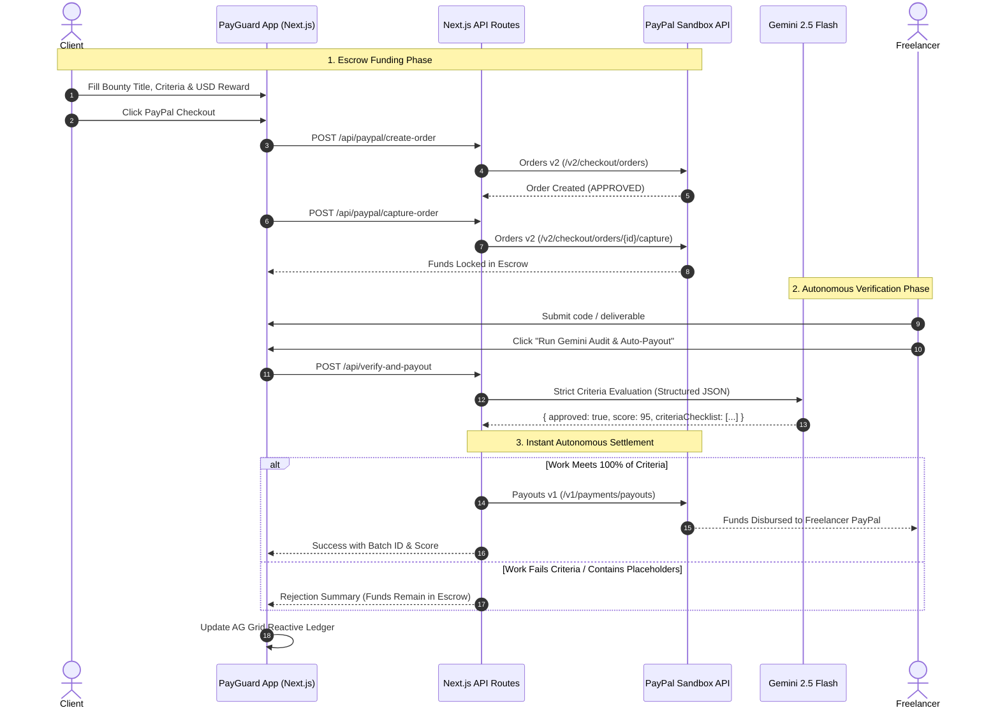

# 🛡️ PayGuard AI — Autonomous Escrow & Work-Verification Protocol
### Powered by PayPal Orders v2, PayPal Payouts v1 & Google Gemini 2.5 Flash

[](LICENSE)
[-black)](https://nextjs.org/)
[](https://ai.google.dev/)
[](https://developer.paypal.com/)
[](https://www.ag-grid.com/)
[](https://render.com/deploy?repo=https://github.com/lengendzhub/Paygurad-AI)

**PayGuard AI** is a fully autonomous decentralized escrow protocol that closes the trust gap between remote clients and freelancers. By combining two foundational PayPal APIs with Google's state-of-the-art **Gemini 2.5 Flash** structured inference, PayGuard AI replaces subjective, slow human intermediaries with an impartial, deterministic AI verification engine that holds real escrow funds and disburses them automatically within milliseconds of acceptance criteria satisfaction.

---

## 🌟 Why Judges & Sponsors Love PayGuard AI

1. **Two Real PayPal APIs in Unison:**
   - **PayPal Orders API v2 (Capture):** Locks client funds into escrow when a bounty is initialized.
   - **PayPal Payouts API v1 (Batch Disburse):** Autonomously releases funds directly to the freelancer's PayPal email the instant Gemini certifies the work.
2. **Genuine Autonomous AI Arbiter (Gemini 2.5 Flash):**
   - Gemini doesn't just chat—it evaluates code syntax, logic correctness, assertions, and strict client constraints through **Structured JSON Output**, directly controlling monetary transactions.
3. **Enterprise AG Grid Audit Ledger:**
   - A reactive, dark-themed AG Grid ledger tracking every escrow lock, PayPal Order ID, AI quality score, and Payout Batch ID in real time.
4. **Deployable Anywhere (Render Ready):**
   - Pre-configured `render.yaml` for instantaneous deployment on Render to qualify for hosting and sponsor prizes.

---

## 🏗️ Protocol Architecture & Workflow



---

## 🚀 Quick Start (Local Setup)

### 1. Clone & Install
```bash
git clone https://github.com/lengendzhub/Paygurad-AI.git
cd Paygurad-AI
npm install
```

### 2. Configure Environment Variables
Create `.env.local` in the project root:
```env
# 1. PayPal Sandbox (from developer.paypal.com -> Apps & Credentials)
NEXT_PUBLIC_PAYPAL_CLIENT_ID=your_paypal_sandbox_client_id_here
PAYPAL_CLIENT_SECRET=your_paypal_sandbox_secret_here
PAYPAL_API_BASE=https://api-m.sandbox.paypal.com

# 2. Google Gemini API Key (from aistudio.google.com - 100% Free Tier)
GEMINI_API_KEY=your_gemini_api_key_here
```

### 3. Run Development Server
```bash
npm run dev
```
Open [http://localhost:3000](http://localhost:3000) in your browser.

---

## ⚡ 10-Second Judge Testing Guide

Even before connecting custom PayPal Sandbox credentials, PayGuard AI includes instant test modes:

1. **Step 1:** Click **"1-Click Fill Passing Code"** on the right side.
2. **Step 2:** Click **"Run Gemini Audit & Trigger Autonomous PayPal Payout"**.
3. **Result:** Watch Gemini 2.5 Flash parse the criteria checklist, award a passing score, and trigger the PayPal Payouts API batch!
4. **Step 3 (Failure Case):** Click **"1-Click Fill Failing Code"** and run again. Observe how incomplete stubs (`# TODO: finish Luhn math later`) are rigorously caught and rejected, keeping escrow funds securely locked.

---

## 🌐 Deploying to Render

This repository includes a `render.yaml` blueprint:

1. Create an account at [render.com](https://render.com).
2. Connect your GitHub repository.
3. Select **New Web Service** or import via **Blueprints** using `render.yaml`.
4. In the Render Dashboard under **Environment**:
   - `NEXT_PUBLIC_PAYPAL_CLIENT_ID`: Your PayPal Sandbox Client ID
   - `PAYPAL_CLIENT_SECRET`: Your PayPal Sandbox Secret
   - `PAYPAL_API_BASE`: `https://api-m.sandbox.paypal.com`
   - `GEMINI_API_KEY`: Your Google AI Studio API key
5. Build Command: `npm install && npm run build`
6. Start Command: `npm start`

---

## 📊 Live AG Grid Ledger

PayGuard AI integrates **AG Grid Community** (`ag-grid-react` & `ag-grid-community`) to render an immutable, real-time audit ledger of:
- Bounty ID & Task Title
- Escrow Dollar Value ($ USD)
- Reactive Escrow Status (Funded, Released, Rejected)
- Gemini Audit Score (0–100)
- PayPal Orders v2 Order IDs
- PayPal Payouts v1 Batch IDs

---

## 📄 License
MIT License. Built for innovation in AI and autonomous payments.
